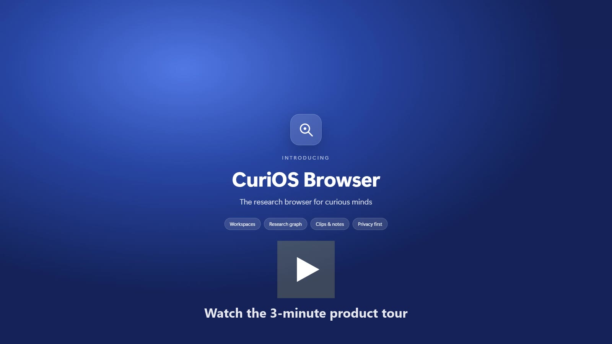
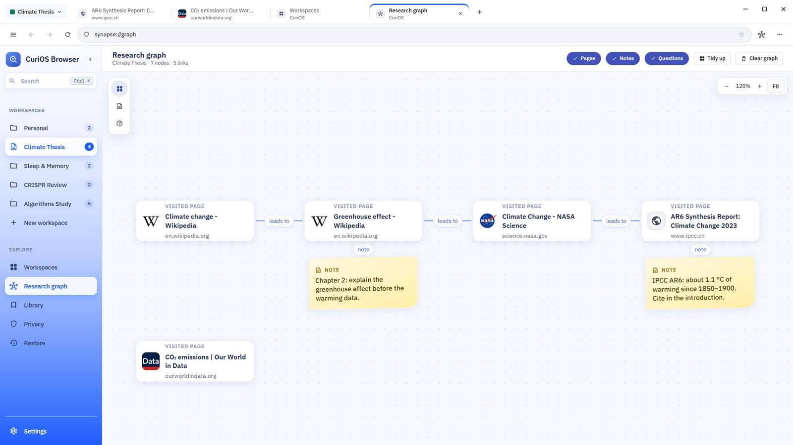
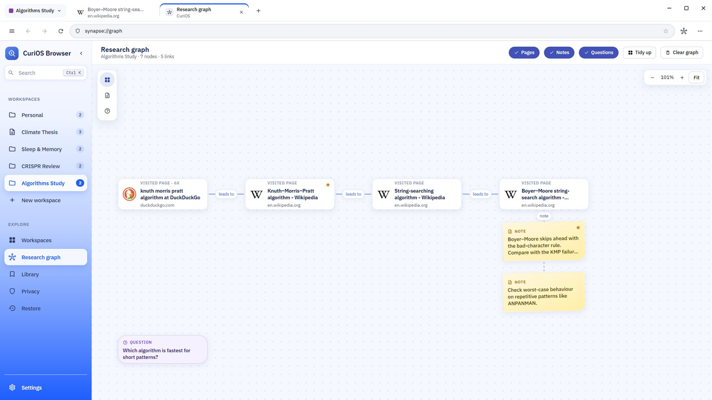
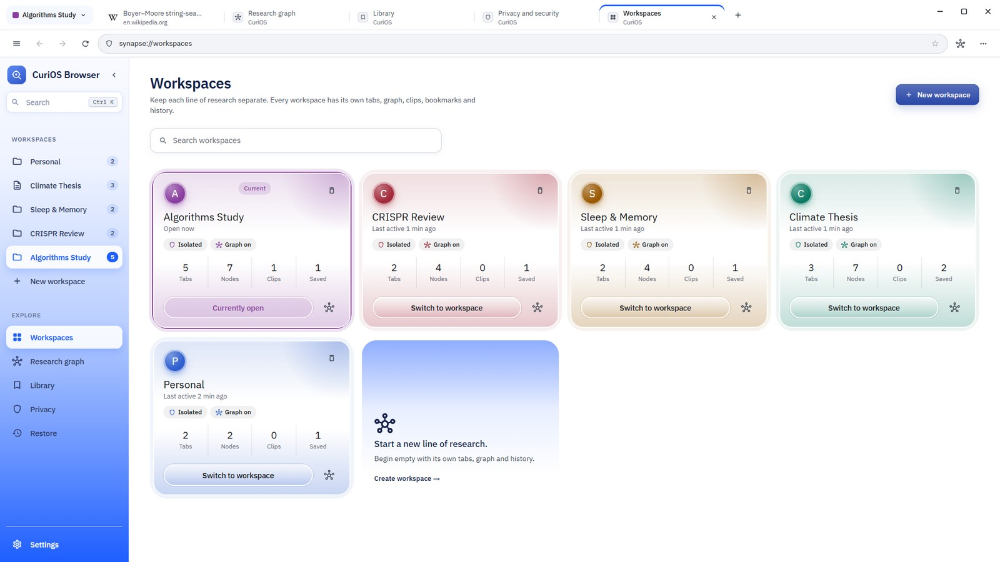
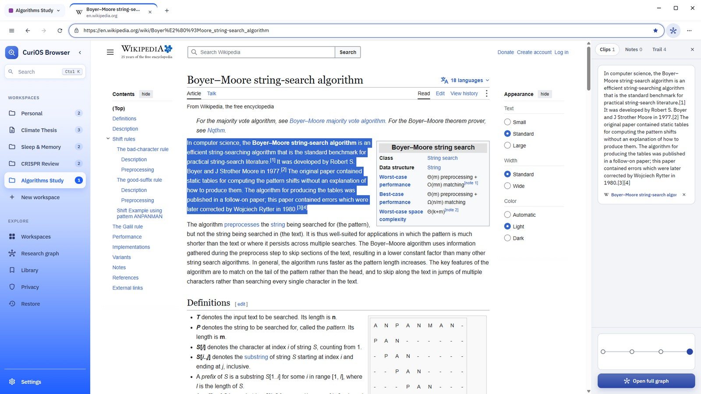
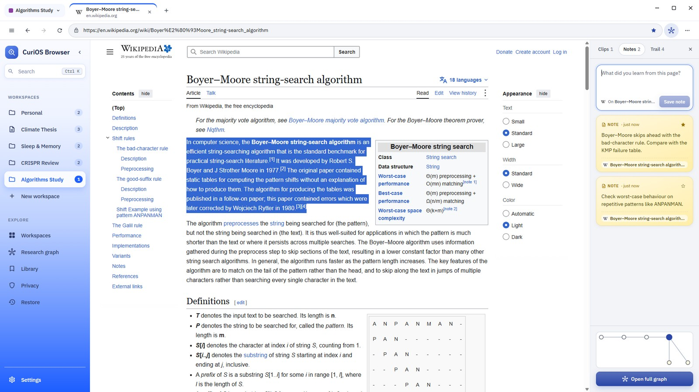
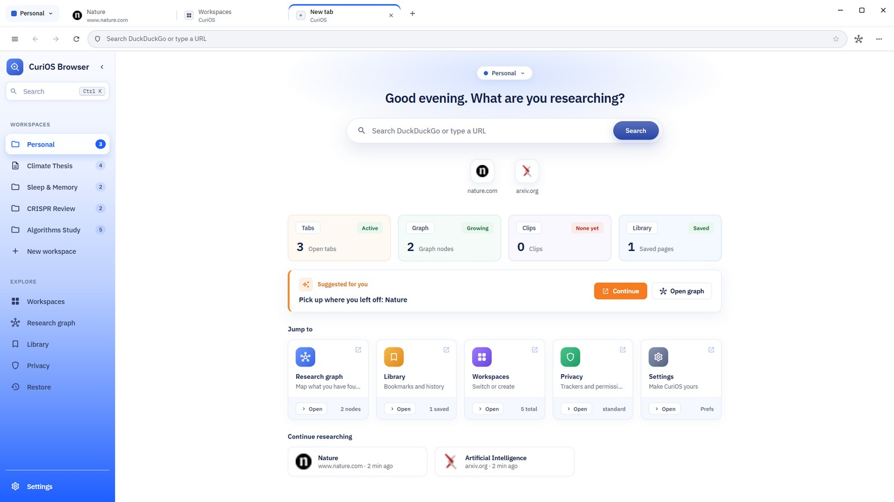
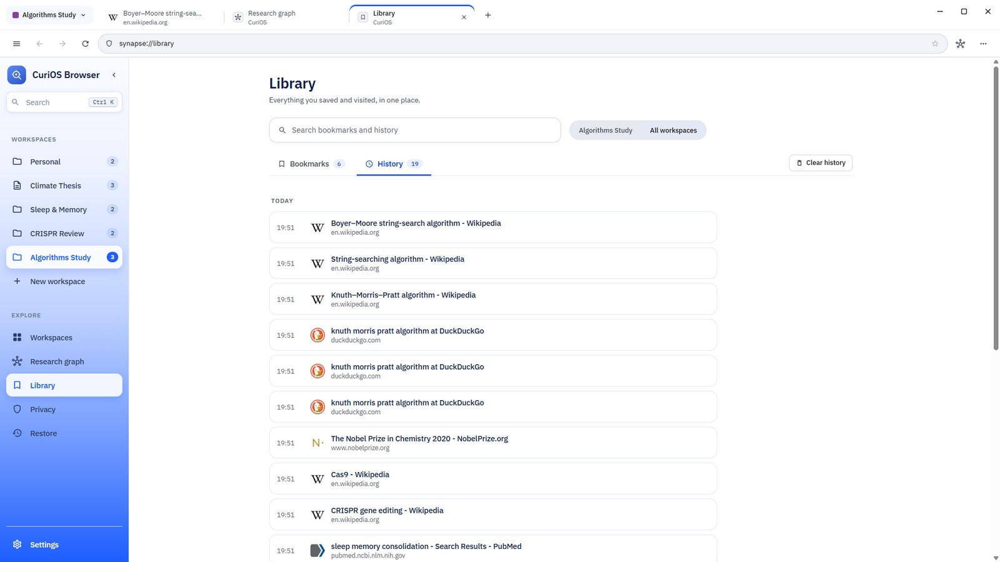
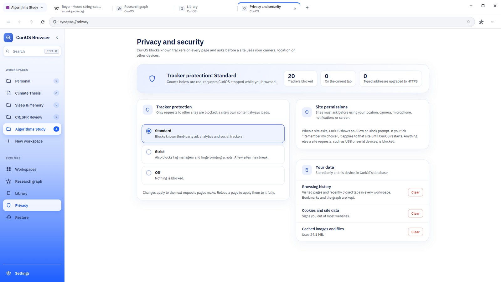

<div align="center">

# CuriOS Browser

**The research browser for curious minds.**

Browse the web, and CuriOS quietly maps how your research fits together:<br>
every page, note and question, linked in a graph, organised by project.

[](docs/media/curios-demo.mp4)

<sub>▶ Click the image to watch the product tour (MP4, 3 min 26 s).</sub>

</div>

---

## What is CuriOS?

Research on the web is messy. You open twenty tabs, follow links three levels deep, copy quotes into a document, and a week later you can't remember where an idea came from or how two sources were connected.

**CuriOS is a desktop browser built for that kind of work.** It's a normal, fast Chromium browser, with a research workspace built around it:

- **It remembers the path.** Every page you visit becomes a card in a **research graph**, and every link you follow draws a line between cards. Your trail of thought is saved as you go.
- **It keeps your thinking next to your sources.** Clip text from any page, write notes linked to the page you're reading, and ask questions right on the graph.
- **It keeps projects apart.** Each **workspace** (a thesis, a literature review, a side project) has its own tabs, history, bookmarks and graph, in its own colour.
- **It stays on your machine.** Everything is stored in a local SQLite database, and trackers are blocked by default.



---

## Highlights

### 🕸️ Research graph
Every page you visit becomes a card, and following a link connects the two. You can:
- add your own **notes** and **questions** anywhere on the canvas
- mark **key sources**
- filter by pages, notes or questions
- drag and zoom freely

**Tidy up** rearranges everything into a clean tree in one click. Open it any time with **Alt+G**.



### 🗂️ Workspaces for every project
Each workspace keeps its own tabs, history, bookmarks, clips and graph, in its own colour. Switch between them from the tab bar, the sidebar or with **Alt+1 … Alt+9**.



### ✂️ Clips and notes beside the page
Select text on any page, right-click and choose **Clip to research panel**, or add it straight to the graph as a note.

The research panel next to the page keeps three things:
- your **clips**
- **notes** linked to the page you're reading (starred notes stay at the top)
- your **trail** through the session

| Clip from any page | Notes linked to the page |
|---|---|
|  |  |

### 🔎 Search, find and come back
- The address bar searches **Google, Bing or DuckDuckGo**, with live suggestions as you type, plus matches from your history, bookmarks and open tabs.
- The **command palette (Ctrl+K)** finds any tab, page, workspace or action.
- The **library** keeps bookmarks (**Ctrl+D**) and history grouped by day, searchable for one workspace or all of them.
- **Session snapshots** save every open tab to reopen later, and closed tabs come back with **Alt+Shift+T**.

| Start page | Library |
|---|---|
|  |  |

### 🛡️ Private by default
- **Tracker blocking** has three levels:
  - **Standard** blocks ad, analytics and social trackers.
  - **Strict** also blocks tag managers and fingerprinting.
  - **Off** blocks nothing.

  Live counts show how much was blocked.
- **Sites must ask** before using your location, camera, microphone, notifications or screen. USB, serial and similar device access is blocked.
- **History, cookies and the cache** can each be cleared in one click, always with a confirmation first.
- **Nothing leaves your device** except the pages you visit and the search suggestions you ask for.



### 🎛️ Built for comfort
- Tabs on top or in a sidebar (vertical tabs).
- A collapsible sidebar.
- A full right-click menu on every page:
  - open or copy links
  - copy images
  - search for the selected text
  - view the page source, or inspect the page
- Keyboard shortcuts for everything, and they work even while a web page has focus.

---

## Getting started

**Requirements:** Node.js 22 or newer, and npm.

```bash
cd frontend
npm install
npm start
```

`npm start` runs the Vite dev server and opens the CuriOS window once the server is ready.

### Scripts

| Command | What it does |
|---|---|
| `npm start` | Runs the full desktop app in development mode. |
| `npm run dev` | Runs only the web UI at http://localhost:5173. This is a preview: web pages open in a limited frame, and tracker blocking, real tabs and the database are not available. |
| `npm run electron` | Opens the desktop window against an already-running dev server. |
| `npm run build` | Builds the UI into `dist/`. |
| `npm run dist` | Builds the UI and packages the app with electron-builder. Packaging is not configured or tested yet. |

### Keyboard shortcuts

| Shortcut | Action |
|---|---|
| Ctrl+K | Command palette |
| Ctrl+D or Alt+D | Bookmark the current page |
| Alt+T | New tab |
| Alt+Shift+T | Reopen closed tab |
| Alt+W | Close tab |
| Alt+G | Research graph |
| Alt+R | Reload |
| Alt+← / Alt+→ | Back / Forward |
| Alt+1 … Alt+9 | Switch workspace |

---

## Project structure

```
frontend/
├─ electron/                 Electron main process
│  ├─ electron.cjs           App window and startup
│  ├─ tabs.cjs               One Chromium view per tab, context menu, shortcuts
│  ├─ privacy.cjs            Tracker blocking, permissions, clearing site data
│  ├─ db.cjs                 SQLite database (node:sqlite) with full-text history search
│  ├─ search.cjs             Search suggestions from Google, Bing and DuckDuckGo
│  └─ preload.cjs            The safe bridge (window.desktop) between the UI and Electron
├─ src/                      React UI
│  ├─ components/            Toolbar, tab strip, sidebar, research panel, dialogs…
│  ├─ pages/                 New tab, Graph, Library, Workspaces, Privacy, Settings, Restore
│  ├─ state/                 App state, data model and types
│  ├─ services/              Native tabs, storage and search-suggestion helpers
│  ├─ hooks/                 Persistence, popups over pages, suggestions
│  ├─ styled/MUI/            MUI styled components (no plain CSS files)
│  ├─ styled/theme/          Theme and design tokens
│  └─ utils/                 Graph geometry, suggestions, time formatting…
└─ docs/media/               Demo video and screenshots used in this README
```

### How it works
- **Tabs:** each tab is an Electron `WebContentsView`, a real Chromium page placed over the React content area. When a popup opens, the page is swapped for a screenshot so the popup can sit on top.
- **Storage:** app state is saved to `synapse.db` in Electron's user-data folder.
  - Only changed rows are written, a fraction of a second after each change.
  - Everything is flushed when the window closes.
  - The file keeps the project's earlier name so existing data still loads.
- **Research graph:** new pages are placed in the column to the right of the page they came from, and notes below their page, so cards never overlap. Tidy up lays the whole graph out as a tree.
- **Styling:** every component uses MUI `styled()` with values from the shared theme.
- **Internal pages:** these use `synapse://` addresses, for example `synapse://graph`. The scheme keeps its earlier name for the same reason as the database file.

---

## Tech stack

Electron 45 · React 19 · TypeScript · MUI 9 · Vite 8 · SQLite (`node:sqlite`)
